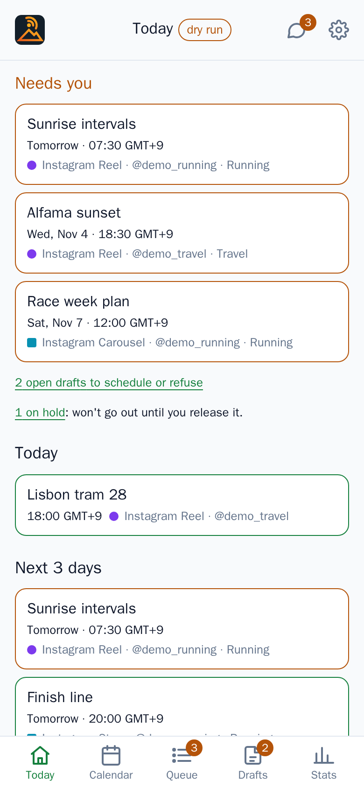
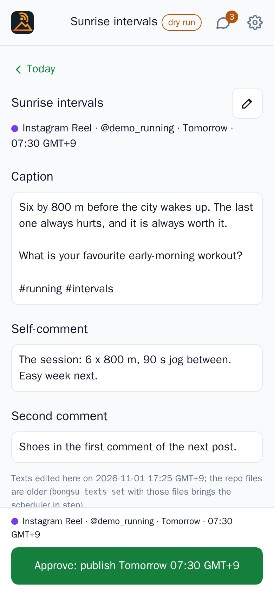
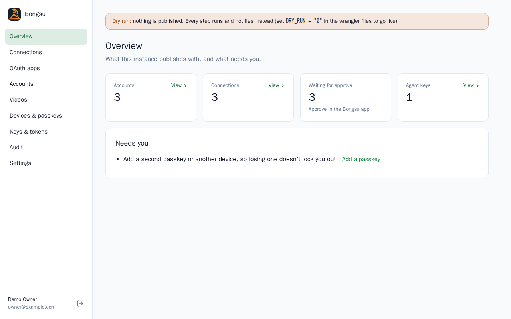

<p align="center">
  
</p>

<p align="center">
  <a href="LICENSE"></a>
  
  
</p>

**Bongsu (봉수)** is a self-hosted publishing scheduler for creators: you approve, it posts on time. You plan Instagram
Reels, posts, carousels, Stories and Trial Reels, and comments on your YouTube Shorts, approve each one with your
passkey, and Bongsu publishes them at the planned minute from your own Cloudflare account or server, with your computer
off. Agents such as Claude can plan with you; only you can say go. (In Joseon-era Korea, *bongsu* was the chain of
beacon towers that carried a signal from peak to peak across the country.)

<p align="center">
  <picture>
    <source media="(prefers-color-scheme: dark)" srcset="docs/assets/readme/today-dark.png">
    
  </picture>
  &nbsp;
  <picture>
    <source media="(prefers-color-scheme: dark)" srcset="docs/assets/readme/item-dark.png">
    
  </picture>
</p>

<p align="center">
  <picture>
    <source media="(prefers-color-scheme: dark)" srcset="docs/assets/readme/overview-dark.png">
    
  </picture>
</p>

## What it does

- **Instagram:** Reels, photos, carousels and Stories, with a first and second comment, alt texts and Trial Reels
  (shown to non-followers first) for accounts that qualify. Through Instagram's own API, or Composio.
- **YouTube:** your comment on each Short once it's public, and moving a scheduled video's release date.
- **Approval with a passkey.** Nothing goes out until you approve it in the app. The approval covers the exact texts
  and media: change either and it waits for you again.
- **Agents that plan, never publish.** A built-in MCP server and REST API let Claude or a script read the queue, write
  captions, add and reschedule posts and propose drafts. No agent key can approve, resume or publish.
- **A phone app** for the daily work (today, calendar, queue, drafts, approvals, comments) and **a dashboard** on your
  computer for accounts, connections, devices, keys and settings.
- **Runs where you choose:** Cloudflare Workers with D1 (the free plan is enough), or Docker on your own server with
  SQLite or Postgres.
- **Media stays on your storage:** a Google Drive folder (files dropped in its inbox become drafts) or a local
  directory.
- **Notifications:** web push to the installed app, optionally an ntfy topic per workspace, and a daily digest.
- **Results and comments:** each post's first results a day after it goes out; new comments in the app, answered from
  there.
- **Your own name and colour** for the app, set at build time.

## How it compares

There are hosted schedulers, services you sign up to (Buffer, Later and Metricool are examples), and self-hosted
open-source schedulers, which run on infrastructure of yours. Bongsu is one of the second kind, built around three
choices:

1. **Your accounts, your apps, your infrastructure.** It posts through the platforms' official APIs with your own
   Meta and Google apps and tokens, on your Cloudflare account or server. No Bongsu service sits in between; the only
   third party is one you choose (Composio, if you post to Instagram that way).
2. **Nothing goes out without your passkey.** Every post and comment is approved by you, and any change asks again.
3. **Agents can plan but never publish.** Give Claude the queue to work on; the final go stays with you.

## Quick start

On **Cloudflare** ([the full guide](site/docs/deploy-cloudflare.md): the variables, secrets and signing up):

```sh
git clone https://github.com/NYT87/bongsu.git && cd bongsu
pnpm install && cd apps/cloudflare && pnpm exec wrangler login
pnpm exec wrangler d1 create bongsu              # database_id, PUBLIC_URL and RP_ID go in both wrangler files
pnpm exec wrangler d1 migrations apply bongsu --remote
cd ../.. && pnpm build && node packages/cli/dist/cli.mjs deploy-secrets   # keep the SETUP_TOKEN it prints; paste the VAPID_PUBLIC_KEY into both wrangler files
cd apps/cloudflare && pnpm run deploy
```

With **Docker** on your own server ([the full guide](site/docs/self-hosting.md): `.env`, Postgres, email):

```sh
git clone https://github.com/NYT87/bongsu.git && cd bongsu
cp .env.example .env                             # PUBLIC_URL, DOMAIN, the keys (openssl rand -hex 32 each)
docker compose --profile https up -d --build     # Caddy gets the HTTPS certificate for DOMAIN
docker compose ps                                # healthy once it's up
# without the https profile it listens on :8787, for your own reverse proxy
```

Then open `/dashboard` on your instance, sign up with the `SETUP_TOKEN` (printed by `deploy-secrets`, in `.env` on Docker) and follow
**Get started**: time zone, OAuth apps, connections, your phone. Start with `DRY_RUN` on: every step runs and
notifies, nothing is published.

## Docs

The guides are at **[nyt87.github.io/bongsu/docs](https://nyt87.github.io/bongsu/docs/)** (and in
[`site/docs/`](site/docs/)), and inside your own dashboard. A few to start with:

- [What is Bongsu](site/docs/what-is-bongsu.md) and [how it works](site/docs/how-it-works.md)
- Accounts: [Instagram](site/docs/instagram-graph.md) (or [through Composio](site/docs/instagram-composio.md)),
  [YouTube](site/docs/youtube.md), [Google Drive](site/docs/drive.md)
- Using it: [the app](site/docs/the-app.md), [the dashboard](site/docs/the-dashboard.md),
  [connect Claude](site/docs/connect-claude.md), [what agents can do](site/docs/what-agents-can-do.md)
- Running it: [configuration](site/docs/configuration.md), [updating](site/docs/updating.md),
  [backups](site/docs/backups.md), [security](site/docs/security.md), [FAQ](site/docs/faq.md)

Developer notes (architecture, the schema, local testing with demo data) are in [docs/](docs/README.md), and the plan
ahead is in the [roadmap](docs/PLAN.md).

## Contributing

Changes are welcome. [CONTRIBUTING.md](CONTRIBUTING.md) says how, [CODE_OF_CONDUCT.md](CODE_OF_CONDUCT.md) is how we
treat each other, and [SECURITY.md](SECURITY.md) is how to report a vulnerability privately.

## License

[MIT](LICENSE) © NYT87
