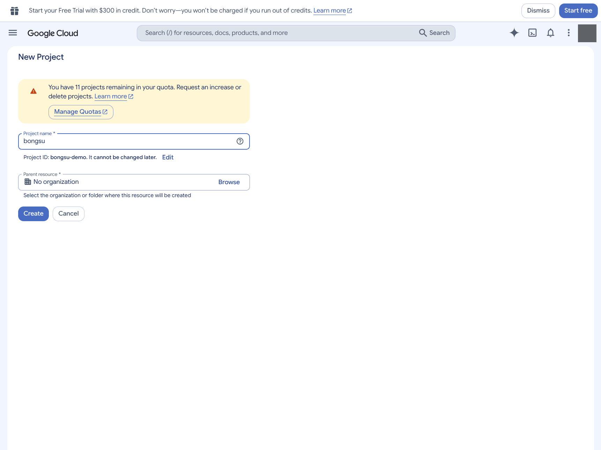
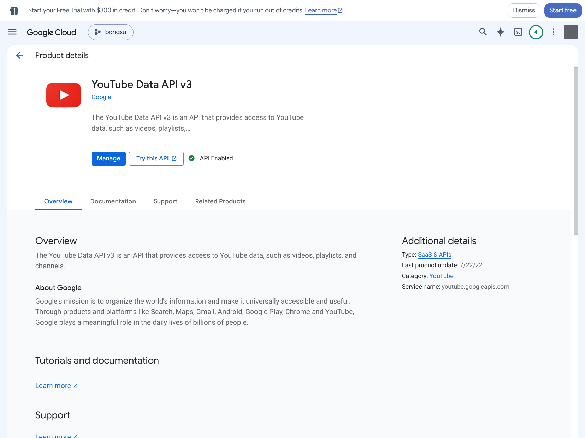
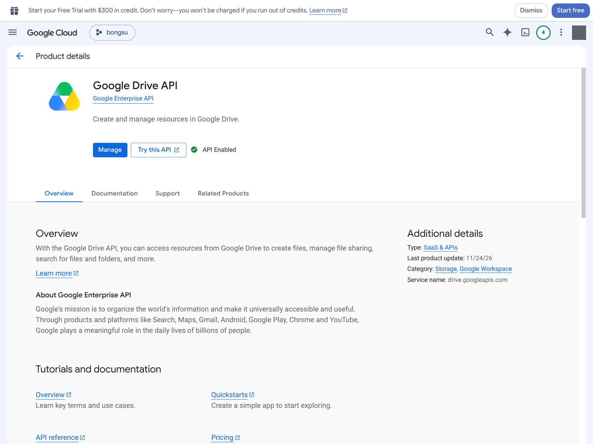
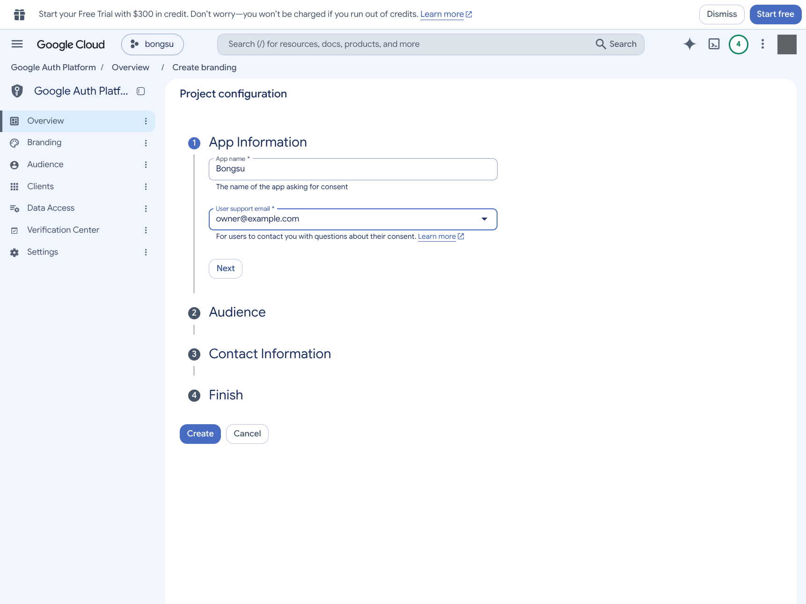
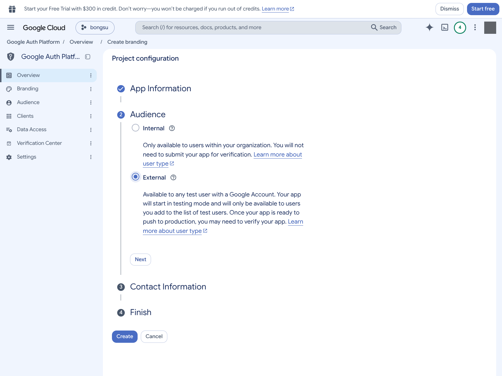
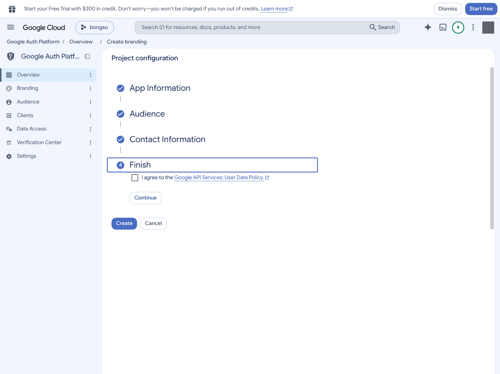
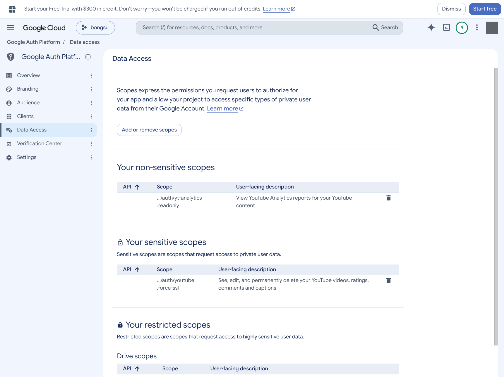
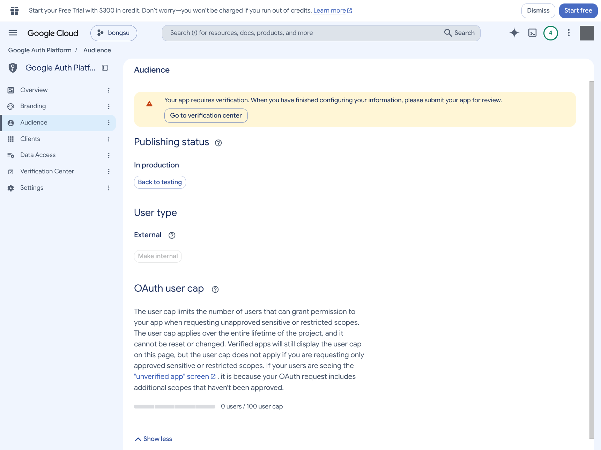
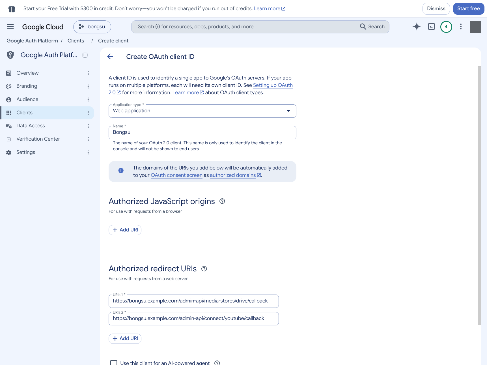

# The Google app (Drive and YouTube)

Bongsu reaches Google Drive and YouTube through an OAuth app of your own in Google Cloud: one app for both, and for
every channel and Drive you connect. You make it once. It takes about fifteen minutes, needs no billing account, and
the console's "Start your free trial" banner can be ignored.

You need your instance's address (`PUBLIC_URL`, for example `https://bongsu.example.com`). Bongsu must be deployed
first: Google checks the privacy page it serves.

## 1. A project

[console.cloud.google.com](https://console.cloud.google.com): the project picker → **New project**. Give it a name
(`bongsu`) and **Create**. The project id under the name can't be changed later.



After **Create**, the console may go back to the project you had open before: pick the new one in the project picker
before going on.

## 2. The APIs

**APIs & Services → Library**: search each API and **Enable** it. Its page then shows **Manage** and "API Enabled".

- **Google Drive API**, for the Drive media store ([Google Drive](drive.md))
- **YouTube Data API v3** and **YouTube Analytics API**, for YouTube ([YouTube](youtube.md))

Enable only the ones you'll use; you can add the others later.





## 3. Google Auth Platform

What used to be the "OAuth consent screen" is now **Google Auth Platform**. A new project shows "Google Auth Platform
not configured yet": **Get started** opens four steps.

1. **App information**: the app name people see when they connect (`Bongsu`), and a support email (yours).

   

2. **Audience**: **External**. It starts in testing mode; you publish it in step 6.

   

3. **Contact information**: your email, for Google's notices about the project.
4. **Finish**: agree to the Google API Services User Data Policy, **Continue**, then **Create**.

   

## 4. The scopes

**Data Access** → **Add or remove scopes**. Under **Manually add scopes** at the bottom, paste the ones you need, one per
line, then **Add to table**, **Update**, and **Save** on the page:

```
https://www.googleapis.com/auth/drive
https://www.googleapis.com/auth/youtube.force-ssl
https://www.googleapis.com/auth/yt-analytics.readonly
```

- `drive`: see, edit, create and delete your Drive files. It lets Bongsu see the files you drop in by hand and move
  them; a narrower one (`drive.file`) only sees what Bongsu made itself. Google lists it as **restricted**.
- `youtube.force-ssl`: manage your YouTube account (uploads, details, comments). **Sensitive**.
- `yt-analytics.readonly`: the subscribers each video brought. Non-sensitive.



## 5. Branding

**Branding** → **App domain**:

- **Application home page**: `<PUBLIC_URL>`
- **Application privacy policy link**: `<PUBLIC_URL>/privacy/`, the page every Bongsu serves (what it keeps, what it
  does with Google data, how to withdraw access)
- **Authorized domains** → **Add domain**: your instance's domain (`example.com` for `bongsu.example.com`; on
  `workers.dev`, your own `<subdomain>.workers.dev`)

**Save**. Without the privacy policy link, **Publish app** stays greyed out ("To publish your app, you must complete
your configuration on the Branding page"). Leave the logo empty: a logo makes Google ask for verification.

## 6. Publish the app

**Audience** → **Publish app** → **Confirm** ("Push to production?"). While the app stays in *Testing*, Google expires
its refresh tokens after 7 days, and Bongsu would lose the Drive and the channels every week.



The banner "Your app requires verification" and the 100-user cap are expected for an app of your own: it works for
your accounts, and Google shows an "unverified app" warning when you connect (**Advanced** → **Go to Bongsu
(unsafe)**). Verification is only needed if other people's accounts will connect.

## 7. The OAuth client

**Clients** → **Create client** (or **Create OAuth client** on the Overview):

- **Application type**: Web application
- **Name**: `Bongsu` (only you see it)
- **Authorized JavaScript origins**: none
- **Authorized redirect URIs** → **Add URI**, once per URL, exactly (`https`, no trailing slash). The admin dashboard's
  **OAuth apps** page lists them on the Google app card:
  - `<PUBLIC_URL>/admin-api/media-stores/drive/callback` for Drive
  - `<PUBLIC_URL>/admin-api/connect/youtube/callback` for YouTube



Leave "Use this client for an AI-powered agent" unticked and **Create**. The dialog that follows shows the **Client
ID** and **Client secret**: copy both now (Google may not show the secret again), or **Download JSON**. Keep that file
out of any repository and delete it once the secret is saved below.

## 8. Into Bongsu

Admin dashboard → **OAuth apps** → **Google app**: paste the client id and secret, **Save**. The secret is stored encrypted
with the instance's `ENCRYPTION_KEY` ([Configuration](configuration.md#secrets)).

Then connect what you'll use: [Google Drive](drive.md#2-pick-a-root-folder-and-connect) and the
[YouTube channels](youtube.md#2-connect-the-channel-from-the-dashboard).
