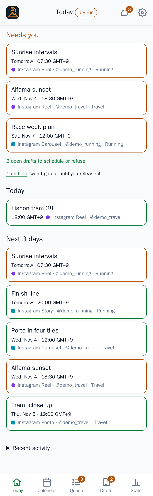
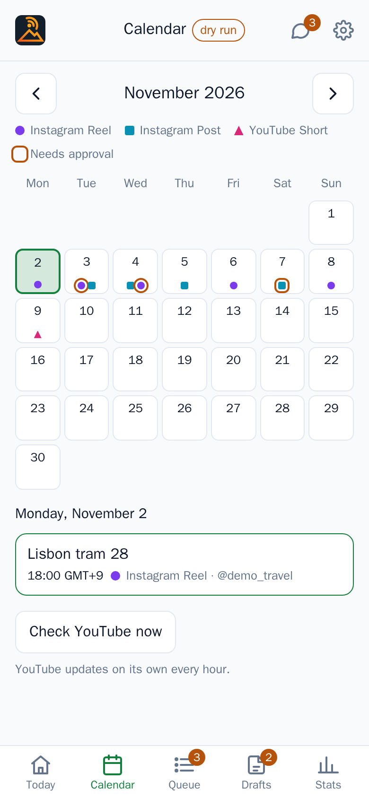
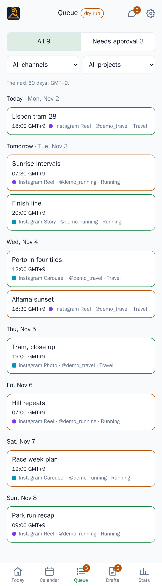
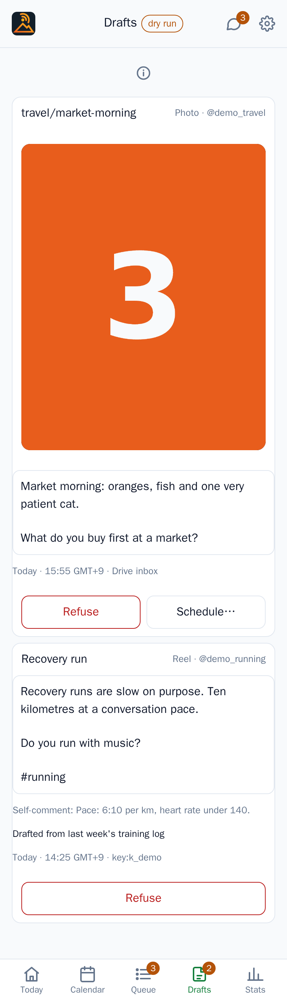
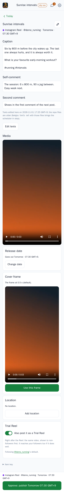
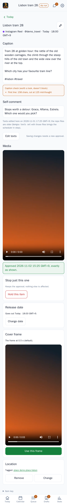
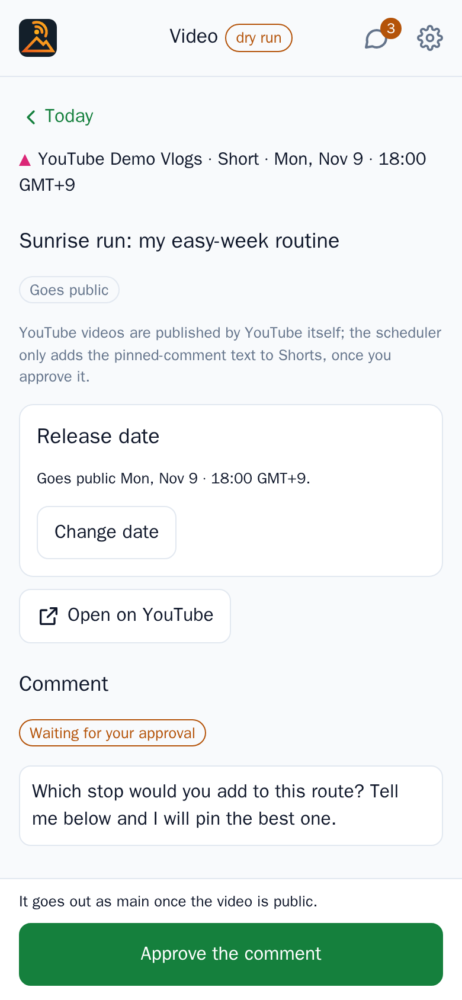
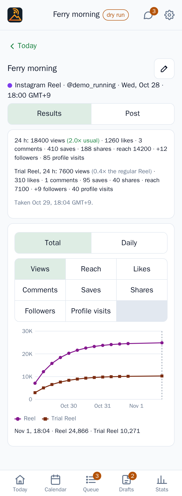
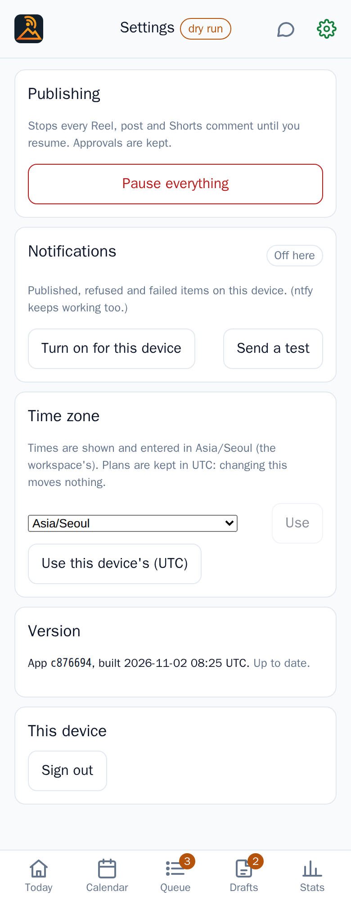
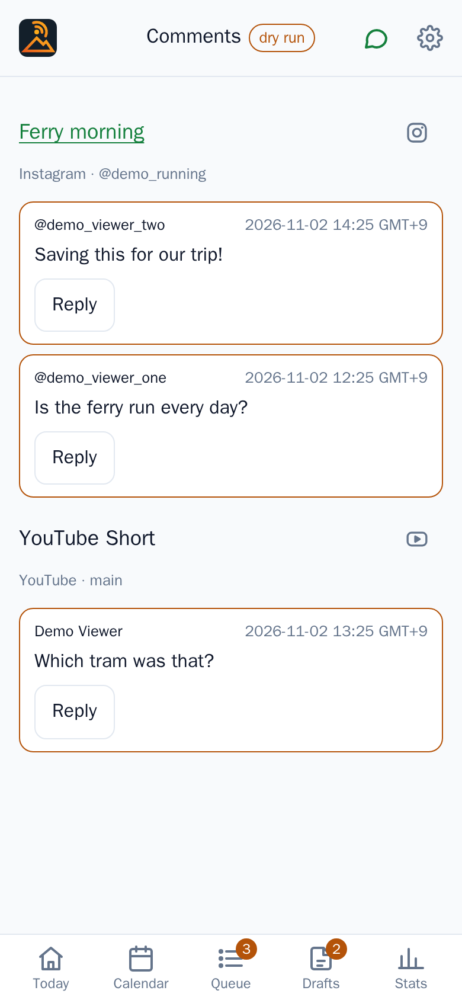

# The phone app

The app is where you check what goes out, approve it and stop it. It is built for a phone, one thumb, a few seconds at
a time, and it works in a desktop browser too. This guide goes through it in the order you meet things.

## Installing it

Open your instance's address on the phone, or scan the QR code from the dashboard. In the dashboard, go to **Devices &
passkeys** and press **Add a device**: it shows a QR code and a code that works once. Scan the QR code with the phone's
camera, open the link and create the passkey when the phone asks. The app's own screen, **Set up this device**, takes
the same code in its **Setup code** field if you type it instead; **Create passkey** finishes it. An attempt that
fails doesn't use the code up.

Then add the app to the home screen, which is also what lets it send notifications. Next time, **Sign in with
passkey**. To add a second phone, use **Add a device** again; **Devices & passkeys** lists every passkey.

If a workspace's admin invited you as a **creator**, you start from their invite link instead: it opens the app, and you
make a passkey (or sign in with the one you already have) and join the workspace. The link works once, for 7 days; ask
for a new one if it has run out. Admins and editors get their links to the [dashboard](the-dashboard.md#members).

## What your role allows

You have a role in each workspace. **Admins** and **creators** do everything in the app: plan, edit texts, drafts and
release dates, approve, pause and resume, connect their accounts. **Editors** do the same except approving, pausing,
resuming and connecting; they leave those to someone else. Either way, approving and resuming ask for your own
passkey. See [Security](security.md#roles).

## Today and "Needs you"

Today opens first. At the top is **Needs you**, and only when something waits on you:

- items that are **overdue**: their time passed and they haven't gone out;
- items to approve or approve again in the next 7 days;
- a link to the open drafts, to schedule or refuse;
- a line for items on hold: "won't go out until you release it".

When nothing waits, the block isn't shown. Under it come **Today**, **Next 3 days** and **Recent activity**, a
collapsed list of the latest notifications.

Every list uses the same row: a title, then the time with its zone, the channel and the account. The row's border says
the state: green for approved, posted and public, amber for **Needs approval**, **Re-approve** and **On hold**, red
for failed. The tab bar at the bottom has Today, Calendar, Queue, Drafts and Stats; Queue and Drafts carry a count of
what needs you. The top bar has Comments and Settings.

## Calendar

A month grid with a coloured dot for each item on a day, and a ring around a dot that needs approval. Tap a day to list
it below. The calendar shows your Instagram items and your YouTube videos. YouTube is read from YouTube itself and
refreshes on its own every hour; **Check YouTube now** reads it at once.

## Queue

The next 60 days, grouped by day. **All** and **Needs approval** (each with a count) switch the list, and the two
selects filter by channel and project. Tap a row to open the item.

## Drafts

Drafts are things that arrived and aren't scheduled: files dropped into Drive's inbox, proposals from an agent, and
what you add yourself. Each shows its media and its texts, with **Refuse** (it asks once, and a refused draft can't be
brought back) and, once it has media, **Schedule…**. A draft without media, such as a proposal from an agent that
hasn't attached any yet, can only be refused.

Scheduling asks for the account, the date and time in your zone, a name, and the texts: **Caption**, **Self-comment**,
**Second comment** and, for images, **Alt texts**. A single image or video can be published as a Reel or Post, or as a
**Story**. If another item already holds that hour on the account, you are told, and free hours appear as buttons to
pick. **Schedule** opens the item's page, where you approve it. Nothing in Drafts is published before that.

**New draft** adds one from the phone: choose files, a project, a name and the texts, then **Upload and create
draft**. The files go from the phone straight to Drive, so the button only appears when uploads are set up (see
[Google Drive](drive.md)).

## The item page

An item's page shows what will be published, as it will be: the target line (channel, account, day, time and zone),
the caption, the self-comment, the second comment, the alt texts and the media. For a video you can also choose the
**Cover frame**. The pencil next to the name sets a display name used by the app, the calendar and the daily summary.

If the caption has warnings, a **Caption check** notice lists them; they don't block. Problems that do block are listed
under **Fix before approving:**. Both come from the checks in [Captions and checks](captions-and-checks.md).

### Approving

The approve bar at the bottom repeats the target and says what will happen: **Approve: publish** and the time. Tap it
and confirm with your passkey. Approving binds exactly what you saw: the texts, the media and the time. The bar then
turns into a confirmation, **Approved.**, with **Done** and **Hold it instead…**.

The page may open on a saved copy, so the button reads **Checking for changes…** until the current version has loaded.
If the item changed while you were looking, the approval is refused, the page reloads the new version and says so;
you approve that one. A button that reads **Fix 2 problems first** stays disabled until the listed problems are fixed.

### After a change

Change a text, the media or the time, whether you, an agent or a file replaced in Drive did it, and the item needs your
approval again: it is marked **Re-approve** and the bar returns. If only the comments changed, the bar says **Approve
comments** and the post itself stays approved.

### Change date

The **Release date** card shows when the item goes out. **Change date** opens a date and time in place; **Save new
date** moves it. For an approved item the app tells you: "It needs approving again for the new time." A time that
clashes with another item on the account is refused, with free hours offered.

### Hold this item

An approved item that hasn't gone out has a **Stop just this one** card with **Hold this item**. It asks once ("Hold this
item?"), needs no passkey and keeps the approval. The item shows **On hold** and won't go out until you press **Release
hold** on the card, which now carries that title. Reach for this before pausing everything.

An approved item whose time passed by more than 6 hours (for instance because the instance was down) isn't posted late.
It waits for you: post it by hand, or move the date and approve again.

## A YouTube video's page

A YouTube row opens the video's page: the channel, Short or Video, the day and time, its state, and **Open on
YouTube**. Bongsu doesn't publish videos, but a scheduled one has a **Release date** card: **Change date**, pick the
date and time, **Save new date**, then confirm with your passkey. For a Short there is also the **Comment** Bongsu posts
as your channel once the video is public, with its **Approve the comment** button. See [YouTube](youtube.md).

## Results

A published Instagram item's page has two views under the target line, **Results | Post**. **Post** is the page as
it was published; **Results** opens first once the post has its 24 h numbers, and the 24 h notification's **Open
results** button lands there. At the top is the 24 h line: views, then how they compare with the account's usual views
("1.4× usual"), likes, comments, saves, shares and reach, then the followers and profile visits the post brought
("+12 followers · 85 profile visits") when Instagram reports them, with the time the sample was taken. A Reel with a
Trial Reel copy also shows the copy's own 24 h line, compared with the regular Reel ("×the regular Reel"), with its
own followers: the point of a Trial Reel is the people who didn't follow you yet.

Under it is a chart of the post's samples (see [How it works](how-it-works.md#results-and-comments) for when they are
taken). **Total | Daily** switches between the running totals and what each day added: a sampled day's growth since
the previous sample, with a gap for a day without one (from day 30, one point a week). The metric picker
chooses **Views** (the default), **Reach**, **Likes**, **Comments**, **Saves**, **Shares**, **Followers** or
**Profile visits**. The Trial Reel copy is a
second line, with its own marker. The line under the legend reads out one point: the latest at first, then the one
you tap or drag to, or pick with the arrow keys. Before the first sample the view says "No results yet: the 24 h
numbers arrive a day after publishing."

A public YouTube upload's page gets **Results | Video** the same way once it has samples, with views, likes and
comments (YouTube gives no reach, saves or shares) and, when the channel was connected with the analytics scope, the
**Subscribers** it gained. A channel connected before that scope existed shows "Subscribers gained: not available
until the channel is reconnected with analytics" instead: see [YouTube](youtube.md#2-connect-the-channel-from-the-dashboard).

## Stats and the channel page

The **Stats** tab lists each account with its follower (or subscriber) count and the change since a day before, then
**Last 7 days, most viewed**: the posts and videos published in the last week with their views, likes and comments,
each opening its Results or video page. Bongsu samples every account's count once a day; an instance that imported
the nightly snapshots of an earlier collector starts with their history. Tap an account for its page: the big count, then a period (**7 days**,
**30 days** or **90 days**), a chart of its followers (**Total | Daily**), a chart of the views its posts added per
day, and **What brought followers**: its posts and videos ranked by the followers they brought in the period, with
each one's share of the period's gain. A row opens the post's Results or the video's page. YouTube's subscriber count
is rounded by YouTube (three significant figures above 1,000), so a channel's daily changes are coarse; the videos'
subscribers need the analytics scope (see [YouTube](youtube.md#2-connect-the-channel-from-the-dashboard)).

## Connecting accounts

Admins and creators connect their own accounts from **Settings → Accounts**: **Connect Instagram** and **Connect
YouTube** sign in with the account and bring you back to Settings, where the accounts it reached are listed.
**Reconnect** signs in again when a connection is marked "needs reconnecting". The accounts belong to the workspace
you're in. If a button says the instance admin has to add its OAuth app first, ask them: the Meta and Google apps are
set up once for the whole instance ([The dashboard](the-dashboard.md#oauth-apps)). Editors don't see this.

If connecting from the app installed on your home screen says to start again, your phone probably opened the sign-in in
a separate browser. Open Bongsu in the phone's browser (Safari on iPhone) and connect from there.

## Pausing a workspace and resuming

**Settings → Publishing** has **Pause this workspace**: "Stops this workspace's Reels, posts and Shorts comments until
you resume. Approvals are kept; other workspaces keep publishing." It asks once. While paused, a red banner,
"Publishing is paused.", sits under the top bar on every screen with a **Resume** link, and the approve button reads
**Approve (held while paused)**. A person resumes, with **Resume with passkey**: approved items go out at their time
again, and any overdue ones go out now (within the 6-hour window). Agents may be allowed to pause (their own
workspace), never to resume.

A pause holds one workspace only, and resuming releases only that one. Admins and creators may pause and resume;
editors may not.

## Notifications and the daily digest

**Settings → Notifications**: **Turn on for this device**, then **Send a test** to check it. They cover published,
refused and failed items on that device. If the browser had been told to block them, the app shows the steps to allow
them again. Each push carries up to two buttons, such as **Open in app**; the optional ntfy topic gets the same buttons.
A device gets the notifications of the workspace it was turned on in, for as long as you're a member of it; **Send a
test** goes to your own devices only. A workspace can also post its notifications to an ntfy topic, set in the
dashboard's **Settings** ([The dashboard](the-dashboard.md#settings)): only that workspace's go there.
Approving always happens in the app.

Once a day, at the digest hour set in the dashboard's **Settings**, one message lists today's items and their state,
what needs approval in the next 3 days and what failed since yesterday. See [How it works](how-it-works.md).

## Comments and replies

The Comments icon in the top bar lists comments on the last two weeks' Instagram posts and YouTube Shorts, per post,
checked every 15 minutes; new ones are highlighted. **Reply** opens a field and **Send reply** posts it straight away.
There is no approval for replies: you write them, so they go out as you wrote them.

## Offline and old data

When the app can't reach the instance it shows what it saved last, in an amber notice: "Showing what was saved at
08:07 GMT+9. Offline: couldn't reach the scheduler." with **Try again**. You can read the plan this way, but an item
can only be approved once its current version has loaded. **Settings → Version** says whether the app is current; if a
newer one is deployed, **Update now** reloads it.

## Time zone

Every time is shown with its zone. **Settings → Time zone** picks the one the app shows and takes times in: the
workspace's, or your own ("Use this device's…"). Plans are stored in UTC, so changing it moves nothing. **Back to the
workspace's** undoes it.
