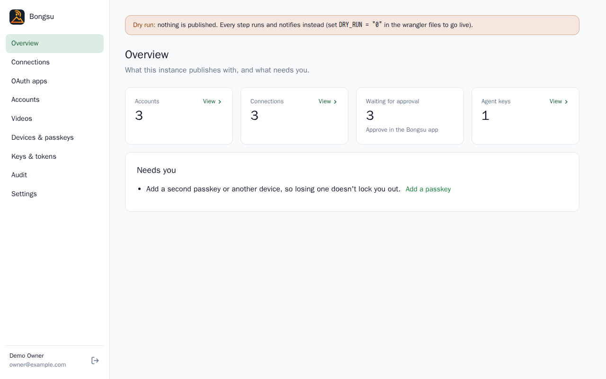
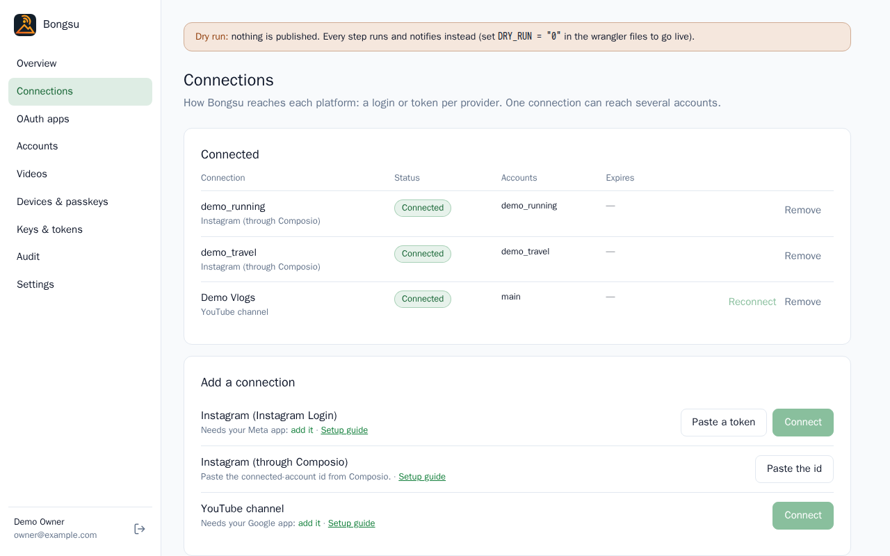
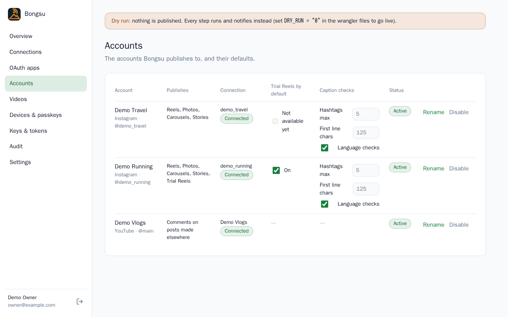
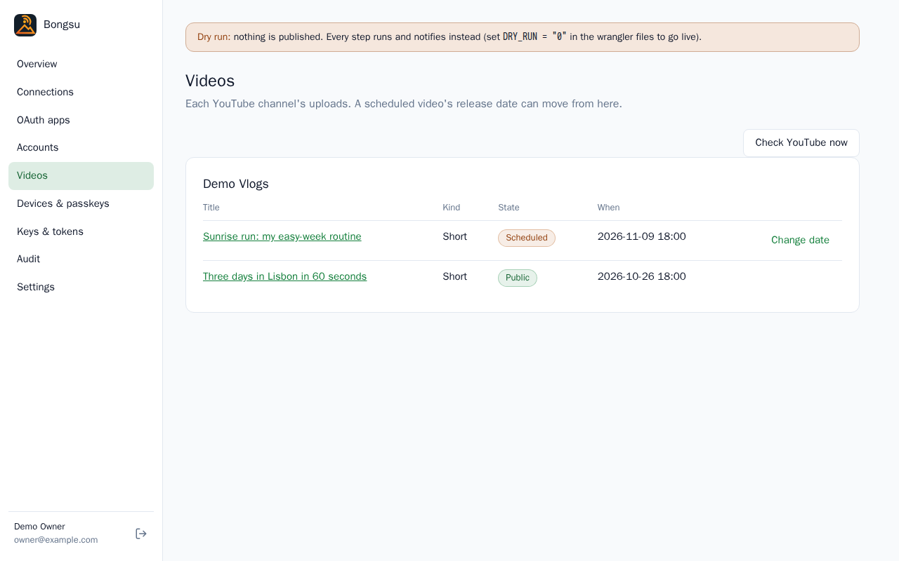
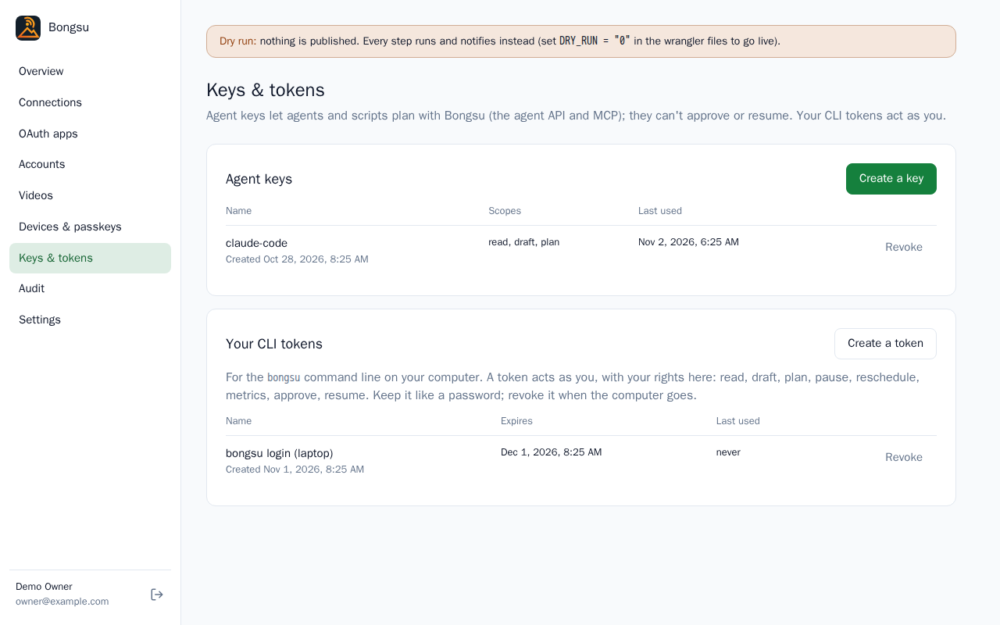

# The dashboard

The dashboard is where you set up and look after an instance: connect accounts, add devices, make keys for agents.
You use it rarely and on a computer. The daily work, approving and watching, happens in the [phone app](the-app.md).
It lives at `https://<your instance>/dashboard` and signs you in with a passkey. Anything that changes who can do what
(connecting, making a key, adding a device, removing something) asks for a fresh passkey check if your last one is
older than 10 minutes. While the instance is in dry run, an amber banner says "Dry run: nothing is published."

The sidebar lists, in order: Overview, Connections, Accounts, Videos, Devices & passkeys, Keys & tokens, Members, Audit
and Settings. An instance admin also has an **Admin dashboard** link at the bottom of the sidebar: the instance's own
pages (Workspaces, Media, OAuth apps and Audit), with a link back to the workspace. This guide follows the sidebar, with the
admin dashboard's pages at the end of their topics.

## People and roles

You work in one workspace at a time, with the role you have in it. **Admins** run the workspace: everything in this
guide, including its connections, keys, settings and members. **Editors** can look at the accounts and videos and manage
their own passkeys, devices and CLI tokens, but they can't change accounts and don't see Connections, agent keys,
Settings or Members. **Creators** don't use the dashboard: signing in here points them to the [phone app](the-app.md),
where they plan, approve and connect their own accounts. An **instance admin** is a person who manages the whole
instance: its workspaces, its media stores and its OAuth apps, and who works in any workspace as its admin. Instance
admins aren't listed among a workspace's members, and don't count as its admins: each workspace keeps one of its own.
[Security](security.md#roles) has the table.

## First run

A new instance has no workspace and no one in it. The first visit to `/dashboard` asks for the `SETUP_TOKEN`, your name
and email and a passkey; that makes you the instance admin, who belongs to no workspace yet. The dashboard then asks
you to **Create your first workspace**: a name, its time zone and its admin: you (preselected), another account
on the instance (its admin right away), or someone new by email (they get an invite link). Once you're its admin it opens on **Get started**; otherwise it waits on the
**Workspaces** page. An instance admin who is a member of no workspace (the instance's workspaces are clients',
say) signs in to the admin dashboard (with their Devices & passkeys), and opens a workspace from
**Workspaces**.

## Overview and Get started

**Overview** counts your accounts, connections, posts **Waiting for approval** (approve those in the app) and agent
keys. Under **Needs you** it lists what to fix: no connection yet, connections that are expiring or broken, fewer than
two passkeys, fewer than three recovery codes left.

Until setup is done, a banner reads "Finish setting up: 2 of 5 done." and **Continue** opens **Get started**. Its five
steps can each be done later from their own page: your time zone and daily digest hour, your OAuth apps, where your
media live, an account to connect, and the device you approve on. The OAuth apps and the media stores are the
instance's: a workspace admin who isn't an instance admin sees those two steps without a button, for the instance admin
to do. A last card, **Then: dry run, and going live**, points to Settings.

## Connections

A connection is how Bongsu reaches a platform: a login or a token. One connection can reach several accounts. **Connected**
lists each with its **Status** (Connected, Expiring or Broken), its **Accounts** and when it **Expires**. **Reconnect**
signs in again; **Remove** keeps the accounts and their plans but publishes nothing to them until they are connected
again, and revokes Bongsu's access where the platform allows it.

**Add a connection** offers three kinds, each with a **Setup guide** link:

- **Instagram (Instagram Login)**: **Connect** signs in with the account, or **Paste a token** takes a long-lived one,
  which Bongsu renews before its 60 days run out. See [Instagram](instagram-graph.md).
- **Instagram (through Composio)**: **Paste the id** takes the connected-account id from Composio. See
  [Instagram through Composio](instagram-composio.md).
- **YouTube channel**: **Connect** signs in with the Google account that owns the channel. See [YouTube](youtube.md).

Google Drive is not a connection here: it is a media store, set up on the **Media** page.

## Media

Where the instance's Reels and photos live (instance admins; a workspace's own stores are in **Settings → Media**). Every workspace uses these stores in its own media folder. **Your stores** lists each one with its **Status** and when it was last **Checked**
(Bongsu checks every store weekly): **Test** checks it reads and writes, **Make default** makes it the store used where
nothing names one (planned items given by a path, drafts from agents, the first choice on the app's upload page), and
**Remove** stops Bongsu reading it, after saying how many waiting approvals that voids. Removing asks for your passkey
again.

You can set up several, one of each kind:

- **Google Drive**: type the **Root folder** (required: a folder at the top of My Drive, or any folder's link), then **Connect Google Drive** signs in with your Google app (add it under OAuth apps first) and makes each
  workspace's folder with its inbox in the root. **Save the root folder** moves to another root later (the folders are
  made there; files already in the old one stay). See [Google Drive](drive.md).
- **S3-compatible bucket**: **Add a bucket** takes the service (AWS S3, Cloudflare R2, Backblaze B2, MinIO or other),
  the bucket, an optional folder in it and a key; **Test and save** saves it only once it answers. See
  [S3-compatible buckets](s3.md).
- **This server's disk**: on Docker and Node, the server's media folder (`MEDIA_DIR`).

Keys and grants are stored encrypted and never shown again.

## OAuth apps

Bongsu signs in to Instagram and YouTube through apps you own: the **Meta app (Instagram)** and the **Google app
(YouTube)**. Each card shows the redirect URL to register in that app, with **Copy**, and takes its ID and secret
(the secret is stored encrypted and isn't shown again). **Replace** changes them; **Remove** stops new connections and
reconnects, but connections already made keep working. Make each app once. If a notice says `ENCRYPTION_KEY` isn't set,
set it first, as the [deploy guide](deploy-cloudflare.md) says.

## Accounts

Each connected Instagram account or YouTube channel is a row:

- **Publishes** says what Bongsu can do with it: Reels, posts and so on for Instagram, and **Trial Reels** when the
  account is set up for them.
- **Trial Reels by default** says whether the account's Reels start as Trial Reels, shown to non-followers first; each
  item can still change it. It reads "Not available yet" for an account that can't post them. See
  [Instagram through Composio](instagram-composio.md) for the limit.
- **Caption checks** holds the account's own rules: **Hashtags max**, **First line chars** and **Language checks**. See
  [Captions and checks](captions-and-checks.md).
- **Made for kids** and **Category** (a YouTube channel only) are the defaults for the channel's new videos; a video's own
  options win. Changing **Made for kids** voids the approval of a planned video that follows the default. See
  [YouTube](youtube.md#channel-defaults).
- **Rename** changes the display name. **Disable** stops all publishing to the account and keeps its plan, and **Enable**
  undoes it. **Remove** is only offered for a disabled account with nothing left to publish, and what was already
  published stays in the history.

## Videos

Each YouTube channel's uploads, with the title, **Kind** (Short or Video), **State** and **When**. **Check YouTube now**
reads the channel at once instead of waiting for the hourly refresh. A scheduled video has **Change date**: pick the date and time,
then **Save**. It moves the release time only; it never makes a video public.

## You

Click your name at the bottom of the sidebar for your own page. **Your name** is how the people you work with see you
(each workspace can also give you another name, on its Members page). **Theme** is System (your device's light or
dark setting), Light or Dark, the same in the app and on every device you sign in on. **Your workspaces** lists each workspace you
belong to with your role there. **Leave** (with a confirm) takes you out of one, in the dashboard and the app at once:
its pages and notifications, your CLI tokens for it and the agent keys you made there. Leaving the one you work in reloads the dashboard in your next
workspace, if you have one. A workspace's last admin can't leave: make someone else admin first. An admin can invite
you again. Leaving is in that workspace's audit log.

## Devices & passkeys

Your devices approve posts in the app; your passkeys sign you in here and there.

- **Add a device** shows a QR code and a code that works once. Scan it with the phone, create its passkey and add the
  app to the home screen. The page says **Connected** when the device is done, and "The code expired before the device
  used it." if it wasn't.
- **Passkeys** lists each with when it was added and last used. **Add a passkey here** adds one on this computer.
  **Remove** is refused for your only passkey: add another first.
- **Recovery codes**: **Make new codes** shows a fresh set once and cancels the old ones. Each signs you in once when
  every passkey is lost (five tries in 15 minutes). Keep them somewhere safe.

Keep two passkeys and a few recovery codes, so losing a phone doesn't lock you out: Overview reminds you until you have
two passkeys and at least three codes.

**Alert emails** (when the instance sends email): a connection or a media store that broke is emailed to the admins
who look after it, ending with why they got it and a link here. Untick **Email me these alerts** to stop them, for
every workspace and the instance at once; the notice still shows in the dashboard and in the app's notifications.

## Keys & tokens

**Agent keys** let an agent or script use Bongsu's API and MCP. **Create a key** asks for a name and what it can do:
`read` (the plan, jobs and notifications), `draft`, `plan` (add, reschedule, hold and remove items), `pause`, and
`reschedule` (move a YouTube release date; not given by default) and `metrics` (upload metrics samples collected
elsewhere; not given by default). Start with `read`, `draft` and `plan`. The key is
shown once; copy it then. A key can't approve or resume, whatever its scopes, and **Revoke** stops it at once. See
[Security](security.md).

**Your CLI tokens** are for the `bongsu` command on your computer. A token acts as you, so keep it like a password:
**Create a token**, name the computer and choose how many days it lasts, and **Revoke** it when the computer goes.

## Members

The workspace's people and their roles, for its admins. **Invite someone** takes an email and a role (admin, editor
or creator) and makes a link that works once, for 7 days. With email set up
(`MAILER`, [Configuration](configuration.md)) it's also sent to them. Admins and editors join in the dashboard,
creators in the app: someone new makes a passkey, someone with a Bongsu account signs in with theirs. Pending invites
are listed with **Copy link**, which shows the same link again until it's used, expires or is revoked (it asks for your
passkey, and the audit log records it), and **Revoke**. Copy link needs `ENCRYPTION_KEY`: the link is kept encrypted
with it. Invites made without it, or before this release, show their link only once.

Each member is listed by the name this workspace shows for them, with their email. **Edit name** (admins) sets that name
for this workspace only, up to 60 characters, and an empty one goes back to the person's own name; people can also set
it themselves in the app's [Settings](the-app.md#your-name). The audit log and the pages that say who approved,
paused or drafted something use the same name.

Each member's role can be changed in place, and **Remove** takes them out of the workspace at once: signed out of
it, their CLI tokens for it and the agent keys they made there revoked (still listed, marked revoked), their devices no longer notified there. A workspace always keeps one admin: make
someone else admin before the last one steps down (an instance admin doesn't count). An admin who's removed or no
longer an admin loses the invites they sent. Each of these changes asks for your passkey. An instance admin also sees
**Make instance admin** by each member; once they are one they leave the list. The admin dashboard's **Workspaces** page
lists the **Instance admins**, with **Remove instance admin** and a way to make anyone on the instance one; the instance
always keeps one.

## Audit

Every change to the workspace, newest first: when, who, what and the detail. **Load older** shows the next 50.

The admin dashboard has its own **Audit**, for instance admins. With no workspace picked (how it opens) it shows the
instance's log: new workspaces, media stores, OAuth apps, instance admins and sign-ins outside any workspace. Pick a
workspace in its **Workspace** list to read that workspace's log instead, as its own admins see it.

## Switching workspaces

The top of the sidebar shows the workspace you work in: its icon (a coloured placeholder until it has one), its name and
your role there. Someone who can open more than one workspace also sees an up-and-down arrow there: it opens the list
of their workspaces, the current one checked; choose another and the dashboard reloads there, with the role they have
in it. Type in **Find a workspace** at the top of the list to narrow it by name (case and accents don't matter); Enter
opens the first match. **⌘K** (Ctrl+K on Windows and Linux) opens the list with the search ready, from any page. The arrow shows for people who are members of several workspaces and for instance admins, who can open all of
them; a person in a single workspace sees only its name.

## Workspaces

Instance admins open the **Admin dashboard** from the bottom of the sidebar (`/dashboard/admin/`): **Workspaces**,
**Media**, **OAuth apps** and **Audit** (see [Audit](#audit)). Anyone else who opens one of its pages is sent back to their workspace.
**Workspaces** lists every workspace with its **Members**, **Accounts**, when it was **Created** and its **Status**.
**Create a workspace** takes a name, a time zone and its admin: you, an account already on the instance
(its admin right away), or someone new invited by email (copy their link). **Open** works in that workspace, as its admin, until you open another (the sidebar's switcher does the same).
**Rename** changes its name (its own admins can also rename it in **Settings**), and **Add an admin** makes an invite
link for a new admin.

A workspace's name opens its own page (`/dashboard/admin/workspaces/<id>`): its id, media folder, creation date and
status with the same actions, its **People** (each member and their role, and the pending invites in the same list,
marked with when they expire, with **Copy link** and **Revoke**), and its **Connected accounts** (each account's
platform, connection and status; to change them, open the workspace). Instance admins aren't listed among its people.

**Archive** stops a workspace completely: nothing in it publishes, its agent keys and CLI tokens stop working, its
members can't open it, it gets no daily digest and its comments and metrics are no longer read. Its plan, texts, accounts and people stay, and **Restore** brings it
back as it was (posts that came due meanwhile go out only within the catch-up window). Archiving, restoring and adding
an admin ask for your passkey again. A workspace's own admins can archive it too (**Settings → Archive this
workspace**); only an instance admin restores one.

**Scheduler** is a read-only section for instance admins. For each run (Instagram, Shorts, upkeep): its cron
expression, the variable that sets it or "default", its next time in your zone, and its last run (when, the calls it
used of its limit, and the steps that stopped on their share). An invalid expression shows in red with the reason,
and runs that share a minute get a warning (they share one invocation's CPU and its calls): two publishing runs, or
upkeep when the minute after its own is taken too (otherwise it simply runs a minute later). Below, the limits the
latest runs used: `RUN_SUBREQUESTS` (from the latest run that had it whole, not a part of a shared minute; flagged
when its value was refused and the default used),
`JOBS_PER_TICK` and `INBOX_WORKSPACES_PER_RUN`, and a notice when the schedules are off (`SCHEDULES=off` on Node).
They are set where the instance is deployed, never here: [When the runs happen](configuration.md#when-the-runs-happen),
[How much a run does](configuration.md#how-much-a-run-does).

## Settings

Settings has three tabs: **General**, **Media** and **OAuth apps** (`/dashboard/settings`, `/settings/media`,
`/settings/apps`).

**Media** (admins) sets the workspace's **media folder** (the workspace's id unless another name was given when it was
made, so a rename never changes it; `UPLOADS` for a workspace kept from before folders had names). A new name renames
the folder in place in Google Drive and on the server's disk, files and all; a bucket gets a new folder and its files
stay in the old one. A name a store already has a folder for is refused: folders are never merged. It also sets its own S3
bucket or Google Drive (with a root folder of its own; **Add Google Drive** shows once the workspace has its own Google
app in **OAuth apps**, which a Drive of its own always connects with). A workspace's default store is its own if it has one, else the instance's. A file must be in the
workspace's own store or inside its folder in an instance store, or it's refused with "not in this workspace's media".
The inbox scans `<folder>/inbox` in each of the workspace's stores, a few workspaces per run in turn.

**OAuth apps** (admins) holds the workspace's own Meta and Google apps, with the same redirect URLs as the instance's. A
connection uses the workspace's app if it has one, else the instance's, and keeps the one it started with. Without one
of its own, each app's card says **Uses the instance's app**: nothing to set up. **Add your own** uses the workspace's
keys instead, and **Remove** goes back to the instance's. The workspace's own Google Drive is the exception: it needs the
workspace's own Google app.

**General** is the rest of this section.

**Icon** (admins) is an optional picture for the workspace: a square PNG, between 192 and 1024 pixels on a side and at
most 200 KB. **Upload an icon** (or **Replace the icon**) sets it at once and **Remove** takes it away. In the
dashboard it shows beside the workspace's name in the sidebar. In the app it shows in the header and in the workspace
picker, and in the push notifications from that workspace. The installed app's icon on a phone's home screen stays the instance's own, because
it belongs to the app and not to a workspace. Setting or removing the icon is in the audit log.

**Workspace** holds its **Name** (it can't be emptied), the **Time zone**, the default for everyone (each person can
choose their own in the app), and the **Daily digest** hour, in that zone. **Notifications (ntfy)** optionally posts the
workspace's notifications to an [ntfy](https://ntfy.sh) topic too, on ntfy.sh or your own server: paste the topic's
`https://` address (a protected topic's token as `?auth=…`), **Save**, then **Send a test**. Anyone who knows a topic's
address can read it, so pick a long, random name; it's stored encrypted (the instance needs `ENCRYPTION_KEY`) and the
page only shows its server afterwards. Each workspace has its own; changing or removing it asks for your passkey again.
**Instance** shows the address and whether publishing is **Live** or in **Dry run**. To go live, change `DRY_RUN` where
the instance is configured and deploy again; see [Configuration](configuration.md). The instance's name and colour are
set when the app is built, see [Branding](configuration.md#branding).
**Archive this workspace** (admins, with your passkey and a confirm) stops it completely, as archiving from the admin
dashboard does: nothing in it publishes, its agent keys and CLI tokens stop working and its members can't open it.
Nothing is deleted, but only an instance admin can restore it. The dashboard then opens your next workspace, if you
have one.
