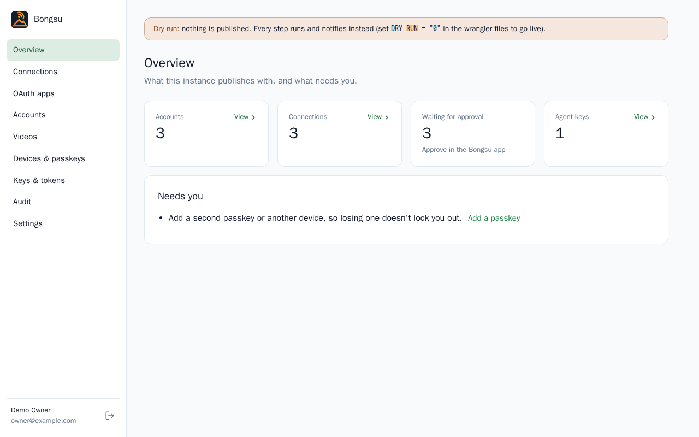
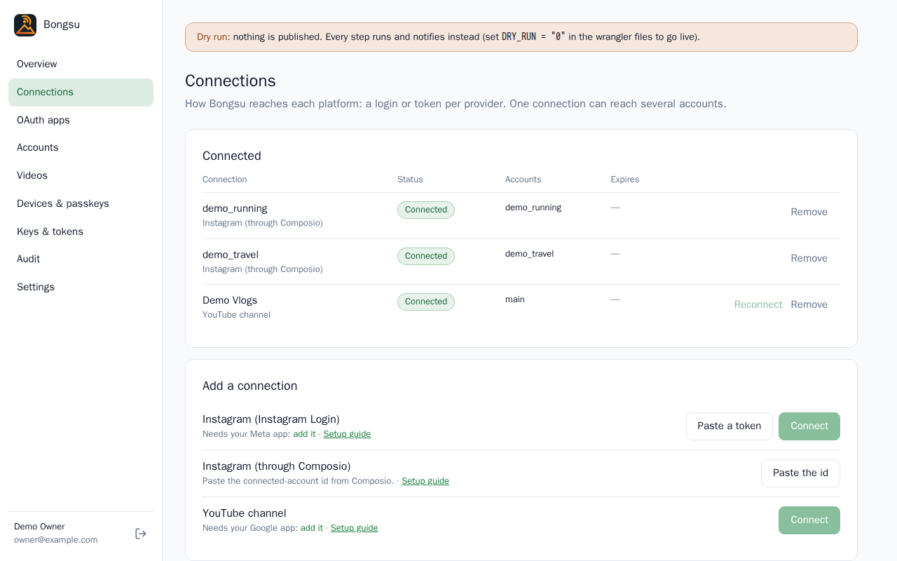
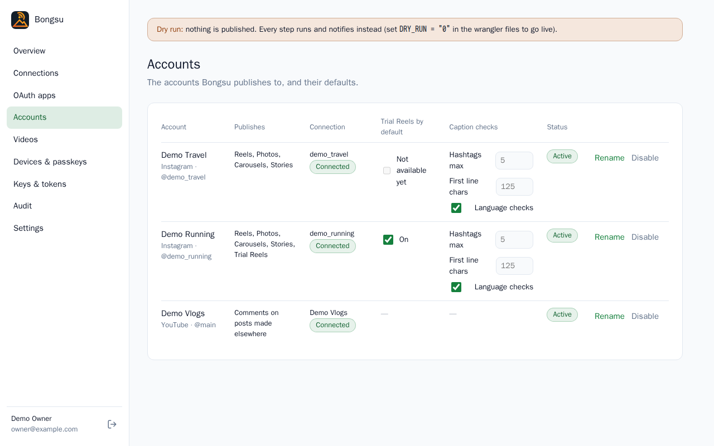
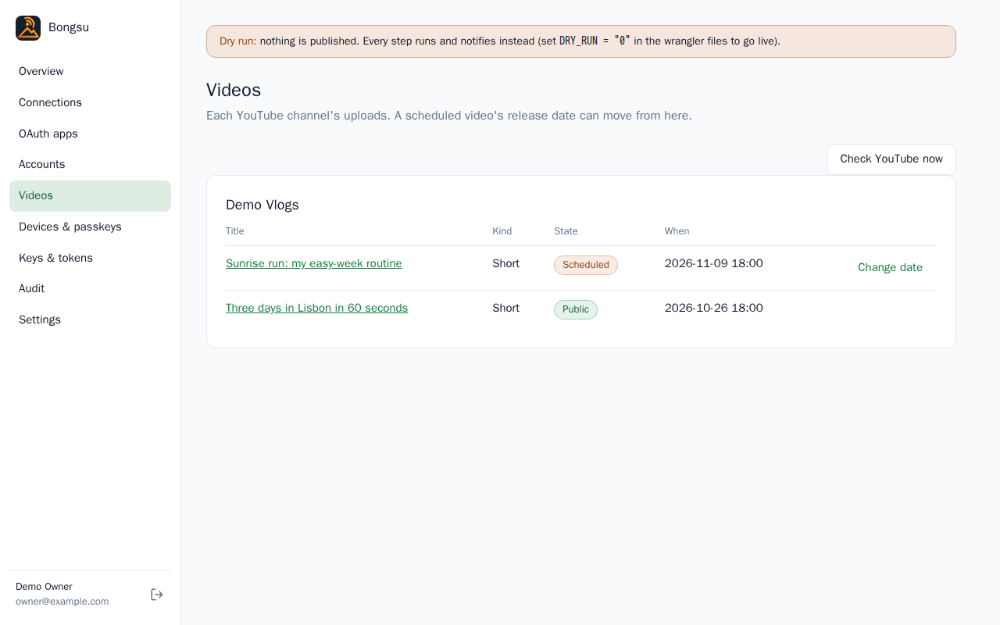
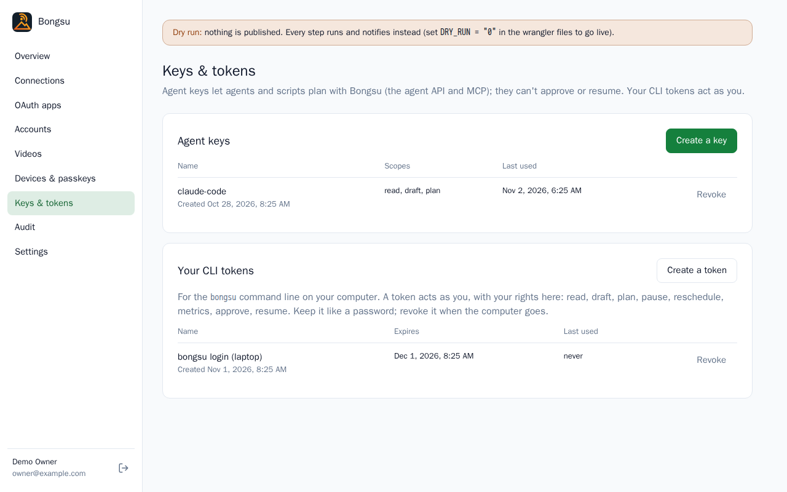

# The dashboard

The dashboard is where you set up and look after an instance: connect accounts, add devices, make keys for agents.
You use it rarely and on a computer. The daily work, approving and watching, happens in the [phone app](the-app.md).
It lives at `https://<your instance>/dashboard` and signs you in with a passkey. Anything that changes who can do what
(connecting, making a key, adding a device, removing something) asks for a fresh passkey check if your last one is
older than 10 minutes. While the instance is in dry run, an amber banner says "Dry run: nothing is published."

The sidebar lists, in order: Overview, Connections, OAuth apps, Accounts, Videos, Devices & passkeys, Keys & tokens,
Audit and Settings. This guide follows it.

## Overview and Get started

**Overview** counts your accounts, connections, posts **Waiting for approval** (approve those in the app) and agent
keys. Under **Needs you** it lists what to fix: no connection yet, connections that are expiring or broken, fewer than
two passkeys, fewer than three recovery codes left.

Until setup is done, a banner reads "Finish setting up: 2 of 5 done." and **Continue** opens **Get started**. Its five
steps can each be done later from their own page: your time zone and daily digest hour, your OAuth apps, where your
media live, an account to connect, and the device you approve on. A last card, **Then: dry run, and going live**, points to Settings.

## Connections

A connection is how Bongsu reaches a platform: a login or a token. One connection can reach several accounts. **Connected**
lists each with its **Status** (Connected, Expiring or Broken), its **Accounts** and when it **Expires**. **Reconnect**
signs in again; **Remove** keeps the accounts and their plans but publishes nothing to them until they are connected
again, and revokes Bongsu's access where the platform allows it.

**Add a connection** offers three kinds, each with a **Setup guide** link:

- **Instagram (Instagram Login)**: **Connect** signs in with the account, or **Paste a token** takes a long-lived one,
  which Bongsu renews before its 60 days run out. See [Instagram](instagram-graph.md).
- **Instagram (through Composio)**: **Paste the id** takes the connected-account id from Composio. See
  [Instagram through Composio](instagram-composio.md).
- **YouTube channel**: **Connect** signs in with the Google account that owns the channel. See [YouTube](youtube.md).

Google Drive is not a connection here: it is a media store, set up on the **Media** page.

## Media

Where your Reels and photos live. **Your stores** lists each one with its **Status** and when it was last **Checked**
(Bongsu checks every store weekly): **Test** checks it reads and writes, **Make default** makes it the store used where
nothing names one (planned items given by a path, drafts from agents, the first choice on the app's upload page), and
**Remove** stops Bongsu reading it, after saying how many waiting approvals that voids. Removing asks for your passkey
again.

You can set up several, one of each kind:

- **Google Drive**: **Connect Google Drive** signs in with your Google app (add it under OAuth apps first). See
  [Google Drive](drive.md).
- **S3-compatible bucket**: **Add a bucket** takes the service (AWS S3, Cloudflare R2, Backblaze B2, MinIO or other),
  the bucket, an optional folder in it and a key; **Test and save** saves it only once it answers. See
  [S3-compatible buckets](s3.md).
- **This server's disk**: on Docker and Node, the server's media folder (`MEDIA_DIR`).

Keys and grants are stored encrypted and never shown again.

## OAuth apps

Bongsu signs in to Instagram and YouTube through apps you own: the **Meta app (Instagram)** and the **Google app
(YouTube)**. Each card shows the redirect URL to register in that app, with **Copy**, and takes its ID and secret
(the secret is stored encrypted and isn't shown again). **Replace** changes them; **Remove** stops new connections and
reconnects, but connections already made keep working. Make each app once. If a notice says `ENCRYPTION_KEY` isn't set,
set it first, as the [deploy guide](deploy-cloudflare.md) says.

## Accounts

Each connected Instagram account or YouTube channel is a row:

- **Publishes** says what Bongsu can do with it: Reels, posts and so on for Instagram, and **Trial Reels** when the
  account is set up for them.
- **Trial Reels by default** says whether the account's Reels start as Trial Reels, shown to non-followers first; each
  item can still change it. It reads "Not available yet" for an account that can't post them. See
  [Instagram through Composio](instagram-composio.md) for the limit.
- **Caption checks** holds the account's own rules: **Hashtags max**, **First line chars** and **Language checks**. See
  [Captions and checks](captions-and-checks.md).
- **Rename** changes the display name. **Disable** stops all publishing to the account and keeps its plan, and **Enable**
  undoes it. **Remove** is only offered for a disabled account with nothing left to publish, and what was already
  published stays in the history.

## Videos

Each YouTube channel's uploads, with the title, **Kind** (Short or Video), **State** and **When**. **Check YouTube now**
reads the channel at once instead of waiting for the hourly refresh. A scheduled video has **Change date**: pick the date and time,
then **Save**. It moves the release time only; it never makes a video public.

## Devices & passkeys

Your devices approve posts in the app; your passkeys sign you in here and there.

- **Add a device** shows a QR code and a code that works once. Scan it with the phone, create its passkey and add the
  app to the home screen. The page says **Connected** when the device is done, and "The code expired before the device
  used it." if it wasn't.
- **Passkeys** lists each with when it was added and last used. **Add a passkey here** adds one on this computer.
  **Remove** is refused for your only passkey: add another first.
- **Recovery codes**: **Make new codes** shows a fresh set once and cancels the old ones. Each signs you in once when
  every passkey is lost (five tries in 15 minutes). Keep them somewhere safe.

Keep two passkeys and a few recovery codes, so losing a phone doesn't lock you out: Overview reminds you until you have
two passkeys and at least three codes.

## Keys & tokens

**Agent keys** let an agent or script use Bongsu's API and MCP. **Create a key** asks for a name and what it can do:
`read` (the plan, jobs and notifications), `draft`, `plan` (add, reschedule, hold and remove items), `pause`, and
`reschedule` (move a YouTube release date; not given by default) and `metrics` (upload metrics samples collected
elsewhere; not given by default). Start with `read`, `draft` and `plan`. The key is
shown once; copy it then. A key can't approve or resume, whatever its scopes, and **Revoke** stops it at once. See
[Security](security.md).

**Your CLI tokens** are for the `bongsu` command on your computer. A token acts as you, so keep it like a password:
**Create a token**, name the computer and choose how many days it lasts, and **Revoke** it when the computer goes.

## Members

The workspace's people and their roles, for its admins. **Invite someone** takes an email and a role (admin, editor
or creator) and makes a link that works once, for 7 days: copy it then, it isn't shown again. With email set up
(`MAILER`, [Configuration](configuration.md)) it's also sent to them. Admins and editors join in the dashboard,
creators in the app: someone new makes a passkey, someone with a Bongsu account signs in with theirs. Pending invites
are listed with **Revoke**.

Each member's role can be changed in place, and **Remove** takes them out of the workspace at once: signed out of
it, their CLI tokens for it revoked, their devices no longer notified there. A workspace always keeps one admin: make
someone else admin before the last one steps down. Each of these changes asks for your passkey.

## Audit

Every change to the instance, newest first: when, who, what and the detail. **Load older** shows the next 50.

## Settings

**Workspace** holds the **Time zone**, the default for everyone (each person can choose their own in the app), and the
**Daily digest** hour, in that zone. **Notifications (ntfy)** optionally posts the workspace's notifications to an
[ntfy](https://ntfy.sh) topic too, on ntfy.sh or your own server: paste the topic's `https://` address (a protected
topic's token as `?auth=…`), **Save**, then **Send a test**. Anyone who knows a topic's address can read it, so pick a
long, random name; it's stored encrypted (the instance needs `ENCRYPTION_KEY`) and the page only shows its server
afterwards. Each workspace has its own; changing or removing it asks for your passkey again. **Instance** shows the address and whether publishing is **Live** or in **Dry
run**. To go live, change `DRY_RUN` where the instance is configured and deploy again; see
[Configuration](configuration.md). The instance's name and colour are set when the app is built, see
[Branding](configuration.md#branding).
